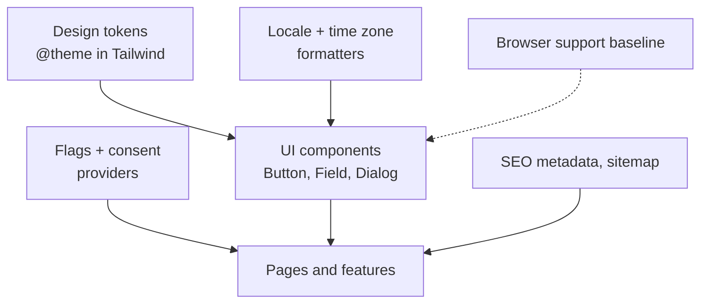

# Cross-Cutting Frontend — Overview
[← Topic](../README.md)

**TECH:** React 19.2 · TypeScript · Tailwind CSS 4 · Next.js 16 where relevant · the platform `Intl` APIs
**LEVEL:** intermediate (mid-level, has shipped production code)

> STACK.md has no i18n, analytics, or feature-flag library. These lessons use platform APIs and small helpers; libraries appear as "also seen". If you adopt one, record it with `/stack revisit`.

## Why this matters in production
- These concerns touch every screen: if they're bolted on late (dark mode, translations, consent), every component must change.
- A design system with tokens and a few solid components makes the whole app consistent, accessible, and faster to build.
- Internationalization and time zones break in ways nobody notices until users in another country complain.
- SEO, analytics, and consent are business-critical and legally regulated in many markets.

## Mental model
Cross-cutting concerns are **platform decisions** made once and applied everywhere through shared primitives: tokens, components, formatters, and providers.

## Prerequisites
- [02-css](../../02-css/README.md) (tokens, responsive, Tailwind), [03-javascript](../../03-javascript/README.md) lesson 04 (Intl, dates).
- [06-rendering](../../06-rendering/README.md) (metadata, Server Components).
- [01-foundations/07-config-environments](../../../01-foundations/07-config-environments/README.md) lesson 03 (feature flags).

## Lesson map
| Lesson | Checklist items |
|:--|:--|
| [01 · Responsive UI, design system, theming, and assets](01-design-system-theming.md) | 1, 2, 3, 10 |
| [02 · Internationalization, dates, numbers, and currencies](02-i18n-dates-numbers.md) | 4, 5 |
| [03 · SEO, browser support, and offline basics](03-seo-browser-support-offline.md) | 6, 9, 11 |
| [04 · Feature flags, analytics, and consent](04-flags-analytics-consent.md) | 7, 8 |
| [Cheatsheet](cheatsheet.md) | all |

## Suggested order
1. 01 first (it shapes every component), then 02–04 as your product needs them.
2. Ready to build: `/learn typescript/02-frontend/12-cross-cutting mode=tasks`.

## Version notes
- Vite's default build target is "Baseline widely available" (since Vite 7); browserslist supports `baseline widely available` queries.
- `Intl.DurationFormat` and Temporal are newer; check support before relying on them in browsers (Temporal is on by default in Node 26).
- Tailwind 4: tokens live in `@theme`; `@custom-variant dark` enables class- or attribute-based dark mode.
- Google requires Consent Mode v2 for ads measurement in the EEA (since March 2024); the Global Privacy Control signal is legally binding for opt-outs in several US states.

## Sources
- [Tailwind CSS — Theme variables](https://tailwindcss.com/docs/theme)
- [MDN — Intl](https://developer.mozilla.org/en-US/docs/Web/JavaScript/Reference/Global_Objects/Intl)
- [Google Search Central — SEO starter guide](https://developers.google.com/search/docs/fundamentals/seo-starter-guide)
- [web.dev — Baseline](https://web.dev/baseline)
- [web.dev — Progressive Web Apps](https://web.dev/explore/progressive-web-apps)
