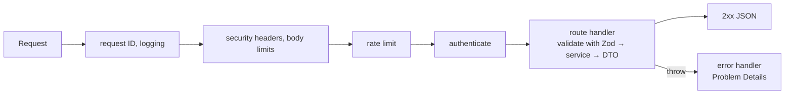

# API Design — Overview
[← Topic](../README.md)

**TECH:** Express 5.2 · Zod 4 (shared schemas) · OpenAPI 3.1 (generated) · Problem Details (RFC 9457)
**LEVEL:** intermediate (mid-level, has shipped production code)

## Why this matters in production
- An API is a contract with every client you have: web, mobile, partners. Breaking it breaks them, often silently.
- Most API incidents are design gaps: retries that double-charge, pagination that skips rows, lost updates, inconsistent errors.
- A consistent, documented API is faster to build against and cheaper to support.
- Express 5 changed routing syntax and async error handling; structure matters more than framework features.

## Mental model
Clients manipulate **resources** through a small, predictable set of operations. Every request passes the same pipeline; every response follows the same conventions.

## Prerequisites
- [01-foundations/02-http-networking](../../../01-foundations/02-http-networking/README.md) (methods, status codes, caching).
- [01-language-runtime](../../01-language-runtime/README.md) and [01-foundations/08-documentation](../../../01-foundations/08-documentation/README.md) (OpenAPI from Zod).

## Lesson map
| Lesson | Checklist items |
|:--|:--|
| [01 · Resources, Express 5 structure, and API styles](01-rest-and-express-structure.md) | 1, 2, 13 |
| [02 · Validation, errors, and response shapes](02-validation-errors-responses.md) | 3, 4, 8 |
| [03 · Pagination, idempotency, and concurrency](03-pagination-idempotency-concurrency.md) | 5, 6, 9 |
| [04 · Evolution, async operations, webhooks, and the contract](04-evolution-async-webhooks-contract.md) | 7, 10, 11, 12 |
| [Cheatsheet](cheatsheet.md) | all |

## Suggested order
1. 01 → 04 in order.
2. Then [03-databases](../../03-databases/README.md) and [04-auth](../../04-auth/README.md), which plug into this structure.
3. Ready to build: `/learn typescript/03-backend/02-api-design mode=tasks`.

## Version notes
- Express 5.2 (5.2.1 current): rejected promises from handlers reach the error handler; route paths use path-to-regexp v8 (`/*splat`, `{/:optional}`, no inline regex); `req.query` is read-only and uses the "simple" parser by default; `req.body` is `undefined` without a body parser.
- RFC 9457 (Problem Details) replaced RFC 7807 in 2023; RFC 9745 (2025) standardizes the `Deprecation` header, next to `Sunset` (RFC 8594).
- The `Idempotency-Key` header is an IETF draft; Stripe's behavior is the de facto reference.
- OpenAPI 3.2 exists (September 2025); this course generates 3.1 for broad tool support.

## Sources
- [Express — Migrating to Express 5](https://expressjs.com/en/guide/migrating-5.html)
- [RFC 9457 — Problem Details for HTTP APIs](https://www.rfc-editor.org/rfc/rfc9457)
- [Microsoft — REST API Guidelines](https://github.com/microsoft/api-guidelines)
- [Zalando — RESTful API Guidelines](https://opensource.zalando.com/restful-api-guidelines/)
- [Stripe API reference (design reference)](https://docs.stripe.com/api)
