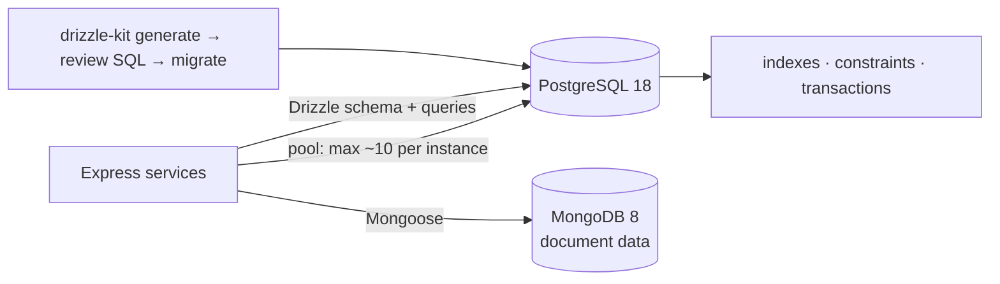

# Databases — Overview
[← Topic](../README.md)

**TECH:** PostgreSQL 18 (primary) with `pg`, then Drizzle ORM and Drizzle Kit · MongoDB 8 with Mongoose 9 (secondary)
**LEVEL:** intermediate (mid-level, has shipped production code)

## Why this matters in production
- The database is where data lives longest and mistakes cost most: a missing constraint lets bad data in for years.
- Most backend slowness is a missing index, an N+1 loop, or an exhausted connection pool.
- Concurrency bugs (lost updates, double bookings) come from misunderstood transactions.
- Migrations are the riskiest routine deploys; done wrong they lock tables or lose data.

## Mental model
Model data so the **database enforces the rules** (types, constraints, relationships). Access it through a **small pool** of connections, with **parameterized** queries, **short** transactions, and **indexes** that match your queries. Change the schema with **reviewed, backward-compatible migrations**.

## Prerequisites
- [02-api-design](../../02-api-design/README.md); basic SQL (SELECT, INSERT, UPDATE).
- Postgres 18 and MongoDB 8 running locally via Docker Compose ([01-foundations/07-config-environments](../../../01-foundations/07-config-environments/docs/01-twelve-factor-and-environments.md)).

## Lesson map
| Lesson | Checklist items |
|:--|:--|
| [01 · Relational modeling, SQL, and data types](01-modeling-sql-types.md) | 1, 2, 8 |
| [02 · Indexes, query plans, N+1, and operations](02-indexes-performance-operations.md) | 3, 9, 13 |
| [03 · Transactions, `pg`, and connections](03-transactions-pg-connections.md) | 4, 5, 10 |
| [04 · Drizzle ORM and migrations](04-drizzle-and-migrations.md) | 6, 7 |
| [05 · MongoDB, Mongoose, and choosing a database](05-mongodb-and-choosing.md) | 11, 12, 14 |
| [Cheatsheet](cheatsheet.md) | all |

## Suggested order
1. 01 → 03 with raw SQL and `pg` (STACK.md: SQL-first), then 04 (Drizzle), then 05 (MongoDB).
2. Migration safety continues in [04-shipping/05-data-safety](../../../04-shipping/05-data-safety/README.md); scaling in [09-scalability](../../09-scalability/README.md).
3. Ready to build: `/learn typescript/03-backend/03-databases mode=tasks`.

## Version notes
- PostgreSQL 18 (September 2025): `uuidv7()` built in, asynchronous I/O, B-tree skip scan, `RETURNING OLD/NEW`, virtual generated columns by default, temporal constraints (`WITHOUT OVERLAPS`), OAuth authentication, data checksums on by default, `EXPLAIN ANALYZE` shows buffers by default; MD5 passwords are deprecated (use SCRAM). PostgreSQL 19 is arriving (REPACK, SQL/PGQ graph queries); STACK.md moves to 19 after 19.1.
- Drizzle ORM: 0.45.x is the stable npm release; 1.0 is in release candidate with a new relational query API (`defineRelations`). These lessons use the stable API.
- Mongoose 9 (November 2025): middleware is async-only (no `next()`), update pipelines are blocked unless enabled, MongoDB Node driver 7, stricter TypeScript types.

## Sources
- [PostgreSQL 18 release notes](https://www.postgresql.org/docs/18/release-18.html)
- [node-postgres documentation](https://node-postgres.com/)
- [Drizzle ORM documentation](https://orm.drizzle.team/docs/overview)
- [MongoDB — Data modeling](https://www.mongodb.com/docs/manual/data-modeling/)
- [Mongoose — Migrating to 9](https://mongoosejs.com/docs/migrating_to_9.html)
