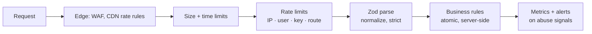

# Validation & Abuse Protection — Overview
[← Topic](../README.md)

**TECH:** Zod 4 at every boundary · express-rate-limit 8 with a Redis 8 store · Express 5
**LEVEL:** intermediate (mid-level, has shipped production code)

> STACK.md marks express-rate-limit (security tooling) as **tentative**; these lessons use it as recorded.

## Why this matters in production
- Every public endpoint is attacked by automation: scrapers, credential stuffers, signup bots, card testers.
- Unvalidated input causes crashes, data corruption, and injection; unbounded input causes outages.
- Business-logic abuse (stacked coupons, double-redeemed gift cards) costs money without any "security bug" in the classic sense.
- Rate limits and limits on size and cost turn floods into 429s instead of incidents.

## Mental model
Treat every request as hostile until proven otherwise: **parse** it into a known shape, **bound** what it can cost, **meter** how often it can happen, and **enforce business rules on the server**.

## Prerequisites
- [01-foundations/06-security](../../../01-foundations/06-security/README.md) lesson 04 (rate-limit basics, SSRF).
- [02-api-design](../../02-api-design/README.md) lesson 02 (Zod validation, Problem Details) and [04-auth](../../04-auth/README.md).

## Lesson map
| Lesson | Checklist items |
|:--|:--|
| [01 · Boundary validation with Zod](01-boundary-validation-zod.md) | 1, 2, 3, 8 |
| [02 · Limits and rate limiting](02-limits-and-rate-limiting.md) | 4, 5, 6 |
| [03 · Bots, webhooks, business abuse, and monitoring](03-bots-webhooks-business-abuse.md) | 7, 9, 10, 11 |
| [Cheatsheet](cheatsheet.md) | all |

## Suggested order
1. 01 → 03.
2. Then [06-caching](../../06-caching/README.md) (Redis patterns used for counters) and [12-integrations](../../12-integrations/README.md) (Stripe webhooks).
3. Ready to build: `/learn typescript/03-backend/05-validation-abuse mode=tasks`.

## Version notes
- express-rate-limit 8: `limit` (not `max`), `standardHeaders: 'draft-8'` for the IETF `RateLimit`/`RateLimit-Policy` headers, IPv6 addresses grouped by `/56` by default (`ipv6Subnet`), and `ipKeyGenerator()` when you build custom keys from IPs.
- Zod 4: `.strict()` objects reject unknown keys; top-level formats (`z.email()`, `z.url()`); `z.stringbool()`; errors via `z.flattenError`/`z.treeifyError`.
- OWASP API Security Top 10 (2023) lists "Unrestricted Access to Sensitive Business Flows" (API6) and "Unrestricted Resource Consumption" (API4), which this topic covers.

## Sources
- [OWASP — Input Validation Cheat Sheet](https://cheatsheetseries.owasp.org/cheatsheets/Input_Validation_Cheat_Sheet.html)
- [OWASP API Security Top 10 (2023)](https://owasp.org/API-Security/editions/2023/en/0x11-t10/)
- [express-rate-limit](https://express-rate-limit.mintlify.app/)
- [IETF — RateLimit header fields draft](https://datatracker.ietf.org/doc/draft-ietf-httpapi-ratelimit-headers/)
- [Zod documentation](https://zod.dev/)
