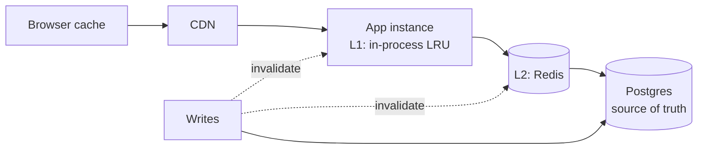

# Caching — Overview
[← Topic](../README.md)

**TECH:** Redis 8 with node-redis 5 · HTTP caching · in-process LRU where it fits
**LEVEL:** intermediate (mid-level, has shipped production code)

## Why this matters in production
- A cache in front of a hot query can cut database load by 90% and p99 latency by an order of magnitude.
- A cache done wrong serves stale prices, leaks one customer's data to another, or collapses the database when a hot key expires.
- Redis is also your session store, rate limiter, and queue backend; its memory and eviction settings affect all of them.
- The cloud target (ElastiCache) runs Valkey or Redis OSS, not Redis 8; portable command choices matter.

## Mental model
A cache is a **copy** of data that is cheaper to read than the source. Every cache entry needs an answer to three questions: **how is it keyed**, **when does it become wrong**, and **what happens when it's missing**.

## Prerequisites
- [01-foundations/02-http-networking](../../../01-foundations/02-http-networking/README.md) lesson 05 (HTTP caching).
- [03-databases](../../03-databases/README.md) (queries worth caching); Redis running locally (Compose).

## Lesson map
| Lesson | Checklist items |
|:--|:--|
| [01 · Why and where to cache; cache-aside](01-why-where-cache-aside.md) | 1, 2, 7 |
| [02 · Invalidation, stampedes, and write patterns](02-invalidation-and-stampedes.md) | 3, 4, 6 |
| [03 · Redis structures, operations, and measurement](03-redis-structures-and-operations.md) | 5, 9, 10 |
| [04 · HTTP caching for APIs and caching pitfalls](04-http-caching-and-pitfalls.md) | 8, 11 |
| [Cheatsheet](cheatsheet.md) | all |

## Suggested order
1. 01 → 04.
2. Then [07-background-jobs](../../07-background-jobs/README.md) (BullMQ on Redis) and [09-scalability](../../09-scalability/README.md).
3. Ready to build: `/learn typescript/03-backend/06-caching mode=tasks`.

## Version notes
- Redis 8 (2025) ships "Redis Open Source" with JSON, search, time series, probabilistic structures, and vector sets built in, under a tri-license (including AGPLv3). New hash commands (`HGETEX`, `HSETEX`, `HGETDEL`) build on hash-field expiration (7.4). 8.4 added atomic compare-and-set/delete for strings; 8.6 added `HOTKEYS` and new eviction policies.
- AWS ElastiCache offers **Valkey** (the Linux Foundation fork of Redis 7.2) and Redis OSS up to 7.x. Core commands match; Redis 8-only features (built-in JSON/search, vector sets, 8.4+ commands) may be missing. STACK.md names Valkey as the fallback: prefer commands that exist in both.
- node-redis 5 is Redis's recommended Node client (RESP3, client-side caching support); BullMQ uses ioredis internally.

## Sources
- [Redis — Caching patterns](https://redis.io/solutions/caching/)
- [Redis 8 release notes](https://redis.io/docs/latest/operate/oss_and_stack/stack-with-enterprise/release-notes/redisce/)
- [node-redis](https://github.com/redis/node-redis)
- [AWS — ElastiCache for Valkey](https://docs.aws.amazon.com/AmazonElastiCache/latest/dg/WhatIs.html)
- [Valkey documentation](https://valkey.io/docs/)
