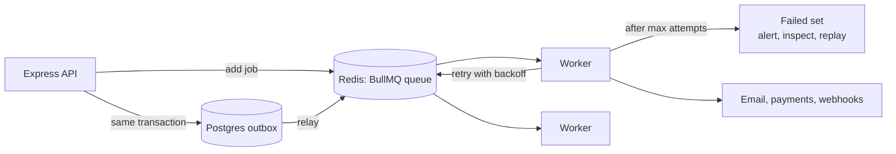

# Background Jobs & Messaging — Overview
[← Topic](../README.md)

**TECH:** BullMQ 5 on Redis 8 · the transactional outbox in Postgres · OpenTelemetry for queue metrics
**LEVEL:** intermediate (mid-level, has shipped production code)

## Why this matters in production
- Slow or unreliable work (emails, PDFs, webhooks, third-party APIs) inside requests makes APIs slow and fragile.
- Jobs run **at least once**: without idempotency, retries send duplicate emails or charge twice.
- A queue nobody watches is a silent outage: failed jobs pile up for days before anyone notices.
- "Save to the DB, then enqueue" loses events when the process dies in between; the outbox pattern fixes it.

## Mental model
The API records **what needs doing** and returns quickly; **workers** do it later, retrying on failure. Every job must be safe to run more than once.

## Prerequisites
- [01-language-runtime](../../01-language-runtime/README.md) (async errors, graceful shutdown), [03-databases](../../03-databases/README.md) (transactions, `SKIP LOCKED`).
- [06-caching](../../06-caching/docs/03-redis-structures-and-operations.md) lesson 03: a separate Redis with `noeviction` for queues.

## Lesson map
| Lesson | Checklist items |
|:--|:--|
| [01 · Why background jobs; BullMQ basics, concurrency, priorities](01-why-and-bullmq-basics.md) | 1, 2, 6 |
| [02 · Retries, idempotency, and failed jobs](02-retries-idempotency-failures.md) | 3, 4, 8 |
| [03 · Scheduling, flows, and graceful shutdown](03-scheduling-flows-shutdown.md) | 5, 7, 9 |
| [04 · Outbox, messaging options, and monitoring](04-outbox-messaging-monitoring.md) | 10, 11, 12 |
| [Cheatsheet](cheatsheet.md) | all |

## Suggested order
1. 01 → 04.
2. Then [08-reliability](../../08-reliability/README.md) and [12-integrations](../../12-integrations/README.md), which run integrations through queues.
3. Ready to build: `/learn typescript/03-backend/07-background-jobs mode=tasks`.

## Version notes
- BullMQ 5: **job schedulers** (`upsertJobScheduler`) replace the old repeatable-jobs API; built-in deduplication options; `UnrecoverableError` to skip retries; telemetry hooks for OpenTelemetry (also seen: `bullmq-otel`).
- Workers need an ioredis connection with `maxRetriesPerRequest: null`; Redis must use `maxmemory-policy noeviction`.
- On AWS, ElastiCache (Valkey/Redis OSS) works with BullMQ; enable Multi-AZ and persistence suitable for queues.

## Sources
- [BullMQ documentation](https://docs.bullmq.io/)
- [BullMQ — Going to production](https://docs.bullmq.io/guide/going-to-production)
- [microservices.io — Transactional outbox](https://microservices.io/patterns/data/transactional-outbox.html)
- [AWS — Amazon SQS](https://docs.aws.amazon.com/AWSSimpleQueueService/latest/SQSDeveloperGuide/welcome.html)
- [Redis — Streams](https://redis.io/docs/latest/develop/data-types/streams/)
