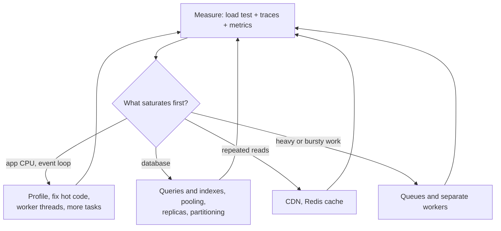

# Scalability & Performance — Overview
[← Topic](../README.md)

**TECH:** k6 for load tests · Node.js 26 profiling and worker threads · PostgreSQL 18 on RDS (pooling, replicas, partitioning) · Redis 8 · ECS autoscaling
**LEVEL:** intermediate (mid-level, has shipped production code)

k6 is a **tentative** row in [STACK.md](../../../../STACK.md) (Load testing); these docs use it as recorded.

## Why this matters in production
- Performance problems show up at the worst moments: launches, sales, a post that goes viral.
- Guessing wastes money and time: teams optimize the wrong layer, or pay for 3× the servers they need.
- Most scaling limits are in the database and other shared resources, not in Node.
- Scaling is a ladder: cheap steps first (queries, caching, more tasks), expensive steps last (sharding).

## Mental model
**Measure → find the bottleneck → apply the cheapest big win → measure again.** Scale the stateless tier horizontally, protect and offload the database, and plan capacity with numbers instead of hope.

## Prerequisites
- [03-databases](../../03-databases/README.md) (indexes, `EXPLAIN`), [06-caching](../../06-caching/README.md), [07-background-jobs](../../07-background-jobs/README.md).
- [08-reliability lesson 03](../../08-reliability/docs/03-breakers-bulkheads-load-shedding.md): load shedding protects you while scaling catches up.
- [10-observability](../../10-observability/README.md) helps a lot: traces show where the time goes.

## Lesson map
| Lesson | Checklist items |
|:--|:--|
| [01 · Measuring and load testing with k6](01-measuring-and-load-testing.md) | 1, 2, 12 |
| [02 · Scaling Node.js: stateless tasks, profiling, worker threads, real-time](02-scaling-nodejs.md) | 3, 6, 11 |
| [03 · Scaling PostgreSQL: pooling, replicas, partitioning, sharding](03-scaling-postgresql.md) | 4, 7 |
| [04 · Offloading work and capacity planning](04-offloading-and-capacity.md) | 5, 8, 9, 10 |
| [Cheatsheet](cheatsheet.md) | all |

## Suggested order
1. 01 → 04.
2. Then [04-shipping/02-cloud](../../../04-shipping/02-cloud/README.md) for the AWS side of scaling.
3. Ready to build: `/learn typescript/03-backend/09-scalability mode=tasks`.

## Version notes
- k6 1.x: runs TypeScript test files directly; open-model executors (`constant-arrival-rate`, `ramping-arrival-rate`); `grafana/setup-k6-action` and `grafana/run-k6-action` for GitHub Actions.
- PostgreSQL 18: asynchronous I/O, B-tree skip scan, and `uuidv7()` (time-ordered keys keep indexes compact as tables grow).
- Node 26: `--cpu-prof`, `--heapsnapshot-signal`, `worker_threads`, `os.availableParallelism()`. In containers, set `--max-old-space-size` explicitly.
- AWS: Fargate tasks from 0.25 to 16 vCPU; ECS target tracking on CPU or `ALBRequestCountPerTarget`; RDS Proxy for pooling; RDS Performance Insights / CloudWatch Database Insights for query load.

## Sources
- [Grafana k6 documentation](https://grafana.com/docs/k6/latest/)
- [PostgreSQL — Performance tips](https://www.postgresql.org/docs/current/performance-tips.html)
- [Node.js — Profiling Node.js applications](https://nodejs.org/en/learn/getting-started/profiling)
- [Amazon ECS — Service auto scaling](https://docs.aws.amazon.com/AmazonECS/latest/developerguide/service-auto-scaling.html)
- [AWS Builders' Library — Avoiding insurmountable queue backlogs](https://aws.amazon.com/builders-library/avoiding-insurmountable-queue-backlogs/)
