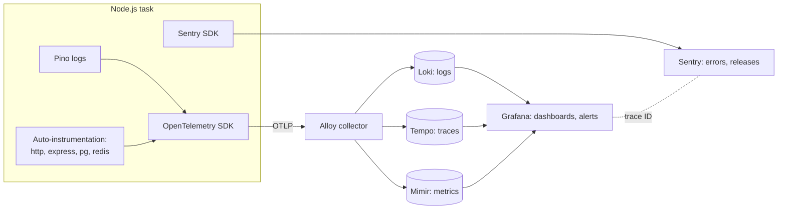

# Observability — Overview
[← Topic](../README.md)

**TECH:** Pino for logs · OpenTelemetry for traces, metrics, and log correlation · Grafana LGTM (Loki, Grafana, Tempo, Mimir) behind an Alloy collector · Sentry for errors, sharing the OpenTelemetry setup
**LEVEL:** intermediate (mid-level, has shipped production code)

## Why this matters in production
- In an incident, the first question is "what is broken, for whom, since when?" Without telemetry, the answer is guesswork across 12 tasks' log streams.
- Bugs that hit 2% of requests never show up in testing. Error tracking tied to releases catches them on the first day.
- Telemetry can leak secrets and personal data, and it can cost more than the servers. Both need deliberate design.
- Alerts that are noisy get ignored; alerts that are missing let outages run for hours.

## Mental model
**Metrics** tell you something is wrong (cheap, aggregated, alertable). **Traces** show where a request spent its time. **Logs** tell you exactly what happened. **Errors** (Sentry) group bugs by cause and release. One **trace ID** links them all.

## Prerequisites
- [08-reliability lesson 04](../../08-reliability/docs/04-degradation-slos-failure-testing.md): SLOs and burn-rate alerts build on these metrics.
- [01-foundations/07-config-environments](../../../01-foundations/07-config-environments/README.md): the local `grafana/otel-lgtm` container in Docker Compose.
- [02-frontend/13-testing-monitoring](../../../02-frontend/13-testing-monitoring/README.md): Sentry in the browser (traces connect frontend and backend).

## Lesson map
| Lesson | Checklist items |
|:--|:--|
| [01 · Observability basics and structured logging with Pino](01-logs-and-pino.md) | 1, 2, 12 |
| [02 · Tracing and metrics with OpenTelemetry](02-tracing-and-metrics.md) | 3, 4, 5 |
| [03 · Grafana LGTM, dashboards, and alerting](03-lgtm-dashboards-alerting.md) | 6, 8, 9, 11 |
| [04 · Error tracking with Sentry; sampling and cost](04-sentry-sampling-cost.md) | 7, 10 |
| [Cheatsheet](cheatsheet.md) | all |

## Suggested order
1. 01 → 04.
2. Then [04-shipping/06-incident-response](../../../04-shipping/06-incident-response/README.md), where you use all of this under pressure.
3. Ready to build: `/learn typescript/03-backend/10-observability mode=tasks`.

## Version notes
- OpenTelemetry JS SDK 2.x: `resourceFromAttributes()`, `spanProcessors` (plural). ESM apps load the SDK with `node --import` and register `@opentelemetry/instrumentation/hook.mjs`.
- HTTP metrics: set `OTEL_SEMCONV_STABILITY_OPT_IN=http` to get the stable `http.server.request.duration` histogram (seconds) with `http.route` and `http.response.status_code`.
- Sentry JS SDK 10 is built on OpenTelemetry. With your own SDK setup, use `skipOpenTelemetrySetup: true` plus Sentry's sampler, propagator, context manager, and span processor.
- Grafana Alloy is Grafana's OpenTelemetry Collector distribution (it replaced Grafana Agent). Locally, `grafana/otel-lgtm` runs a collector, Loki, Tempo, Prometheus, and Grafana in one container.
- Loki 3 ingests OTLP natively: `service.name` becomes the `service_name` label, and trace IDs are stored as structured metadata.
- Node's type stripping keeps line and column positions, so stack traces from `.ts` files are already correct; bundled or transpiled builds still need source maps.

## Sources
- [OpenTelemetry — Observability primer](https://opentelemetry.io/docs/concepts/observability-primer/)
- [OpenTelemetry JS — Node.js getting started](https://opentelemetry.io/docs/languages/js/getting-started/nodejs/)
- [Pino documentation](https://getpino.io/)
- [Grafana Alloy documentation](https://grafana.com/docs/alloy/latest/)
- [Sentry — Express guide](https://docs.sentry.io/platforms/javascript/guides/express/)
- [Google SRE book — Monitoring distributed systems](https://sre.google/sre-book/monitoring-distributed-systems/)
