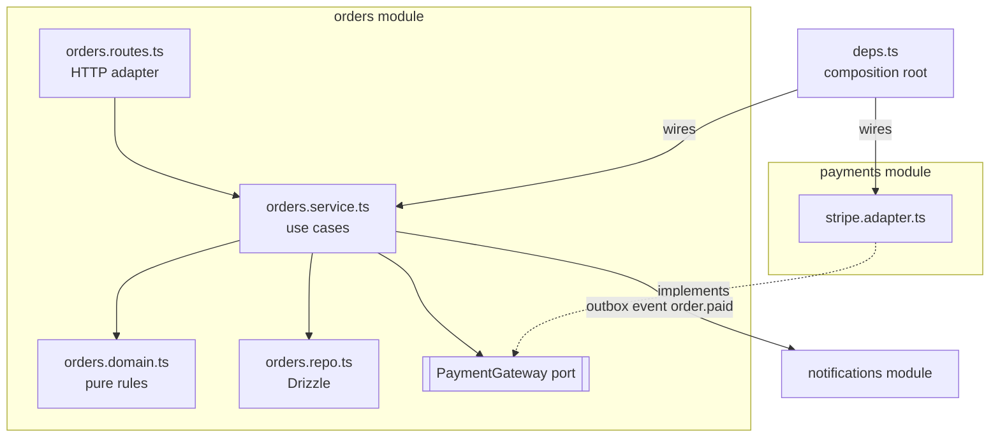

# Architecture — Overview
[← Topic](../README.md)

**TECH:** a modular monolith in Node.js 26 + Express 5 + TypeScript: feature modules, plain-function dependency injection, ports and adapters, domain errors, transactions in use cases, events through the outbox, boundaries enforced by ESLint and tests
**LEVEL:** intermediate (mid-level, has shipped production code)

## Why this matters in production
- Most code is changed many more times than it is written. Structure decides whether a change touches one folder or twelve.
- Business rules buried in route handlers and SQL can't be tested without a server and a database, so they aren't tested.
- Teams that split into microservices too early pay for network failures, distributed transactions, and many pipelines, without the benefits.
- Boundaries that aren't enforced erode within months: "just this one import" becomes a big ball of mud.

## Mental model
Organize by **feature modules**, each with a small **public API**. Inside a module, **dependencies point inward**: HTTP and database code depend on business logic, never the reverse. Everything is **wired once** in a composition root. Split into services only along module boundaries that have proven themselves.

## Prerequisites
- [02-api-design lesson 01](../../02-api-design/docs/01-rest-and-express-structure.md): the feature-folder layout and `createApp(deps)` this topic grows.
- [03-databases lesson 03](../../03-databases/docs/03-transactions-pg-connections.md): transactions and locking.
- [07-background-jobs lesson 04](../../07-background-jobs/docs/04-outbox-messaging-monitoring.md): the outbox.
- [01-foundations/08-documentation lesson 02](../../../01-foundations/08-documentation/docs/02-decisions-runbooks-changelogs.md): ADRs.

## Lesson map
| Lesson | Checklist items |
|:--|:--|
| [01 · Goals, layers, and feature modules](01-goals-layers-modules.md) | 1, 2, 3 |
| [02 · Dependency injection and ports and adapters](02-di-ports-adapters.md) | 4, 7 |
| [03 · Domain logic, errors, and transactions](03-domain-errors-transactions.md) | 5, 6, 11 |
| [04 · Events, service boundaries, decisions, and enforcement](04-events-boundaries-decisions.md) | 8, 9, 10, 12 |
| [Cheatsheet](cheatsheet.md) | all |

## Suggested order
1. 01 → 04.
2. Then [12-integrations](../../12-integrations/README.md): payments, email, and storage as adapters.
3. Ready to build: `/learn typescript/03-backend/11-architecture mode=tasks`.

## Version notes
- Node 26 runs TypeScript by stripping types, so only **erasable syntax** works: no `enum`, no parameter properties, no runtime `namespace`, no decorators. That rules out decorator-based DI containers without a build step; plain functions are the default here.
- TypeScript 6.0 with `erasableSyntaxOnly` and `verbatimModuleSyntax` catches non-erasable syntax at compile time.
- ESLint 10 flat config: `no-restricted-imports` (with `regex` patterns) enforces module boundaries without plugins. Also seen: eslint-plugin-boundaries, dependency-cruiser.

## Sources
- [Martin Fowler — Monolith first](https://martinfowler.com/bliki/MonolithFirst.html)
- [Alistair Cockburn — Hexagonal architecture](https://alistair.cockburn.us/hexagonal-architecture/)
- [Martin Fowler — Microservice premium](https://martinfowler.com/bliki/MicroservicePremium.html)
- [Node.js — Type stripping](https://nodejs.org/api/typescript.html#type-stripping)
- [ESLint — `no-restricted-imports`](https://eslint.org/docs/latest/rules/no-restricted-imports)
