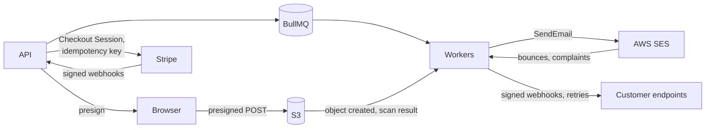

# Common Integrations — Overview
[← Topic](../README.md)

**TECH:** Stripe for payments and webhooks · AWS SES v2 for transactional email · AWS S3 for uploads and files · BullMQ for retries and outgoing webhooks
**LEVEL:** intermediate (mid-level, has shipped production code)

Stripe and SES are a **tentative** row in [STACK.md](../../../../STACK.md) (Integrations); these docs use them as recorded. S3 comes from the decided Cloud row.

## Why this matters in production
- Integrations are where your system meets systems you don't control: outages, rate limits, API changes, duplicate and out-of-order events.
- Money and email are unforgiving. A double charge, or a sending domain with a ruined reputation, hurts customers immediately.
- Uploads are an attack surface: malware, scripts hidden in "images", huge files, guessable URLs.
- Most integration bugs only appear in production unless you use the providers' sandboxes and simulators on purpose.

## Mental model
Every provider sits **behind an adapter** ([11-architecture lesson 02](../../11-architecture/docs/02-di-ports-adapters.md)). Calls go out with **timeouts, idempotency keys, and retries**, usually from BullMQ jobs. Events come back through **verified webhooks**, processed idempotently. A **daily reconciliation** catches whatever slipped through.

## Prerequisites
- [11-architecture lesson 02](../../11-architecture/docs/02-di-ports-adapters.md): ports and adapters.
- [07-background-jobs](../../07-background-jobs/README.md): retries, idempotent jobs, the outbox.
- [05-validation-abuse lesson 03](../../05-validation-abuse/docs/03-bots-webhooks-business-abuse.md): verifying incoming webhooks.
- [08-reliability lesson 01](../../08-reliability/docs/01-failure-modes-timeouts-retries.md): timeouts and retries.
- [02-frontend/10-forms lesson 03](../../../02-frontend/10-forms/docs/03-dynamic-fields-and-uploads.md): the upload UI.

## Lesson map
| Lesson | Checklist items |
|:--|:--|
| [01 · Integration principles and Stripe payments](01-principles-and-stripe-payments.md) | 1, 2, 10 |
| [02 · Stripe webhooks and reconciliation](02-stripe-webhooks-reconciliation.md) | 3, 12 |
| [03 · Transactional email with AWS SES](03-email-with-ses.md) | 4, 5 |
| [04 · Files with S3: uploads, serving, security](04-files-with-s3.md) | 6, 7, 8 |
| [05 · Outgoing webhooks and testing integrations](05-outgoing-webhooks-and-testing.md) | 9, 11 |
| [Cheatsheet](cheatsheet.md) | all |

## Suggested order
1. 01 → 05.
2. Then [04-shipping/02-cloud](../../../04-shipping/02-cloud/README.md) for the AWS accounts, IAM roles, and buckets behind this.
3. Ready to build: `/learn typescript/03-backend/12-integrations mode=tasks`.

## Version notes
- stripe-node pins the API version it was built for. Upgrade the SDK and the API version together, deliberately, after reading the changelog; Stripe uses named versions such as `2025-03-31.basil`.
- AWS SDK v3 is modular: `@aws-sdk/client-sesv2`, `@aws-sdk/client-s3`, `@aws-sdk/s3-request-presigner`, `@aws-sdk/s3-presigned-post`, `@aws-sdk/lib-storage`. On ECS, credentials come from the task role, never from keys in environment variables.
- SES: use the v2 API (`SendEmailCommand` from `client-sesv2`). New accounts start in the sandbox.
- S3: new buckets have Block Public Access on, ACLs disabled (bucket owner enforced), and SSE-S3 encryption by default.
- Gmail and Yahoo sender requirements (since 2024): SPF and DKIM, DMARC, low spam rates, and one-click unsubscribe for bulk mail.

## Sources
- [Stripe documentation](https://docs.stripe.com/)
- [Amazon SES developer guide](https://docs.aws.amazon.com/ses/latest/dg/Welcome.html)
- [Amazon S3 — Presigned URLs](https://docs.aws.amazon.com/AmazonS3/latest/userguide/using-presigned-url.html)
- [Standard Webhooks](https://www.standardwebhooks.com/)
- [OWASP — File upload cheat sheet](https://cheatsheetseries.owasp.org/cheatsheets/File_Upload_Cheat_Sheet.html)
