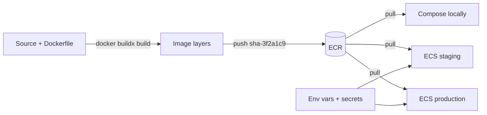

# Containers — Overview
[← Topic](../README.md)

**TECH:** Docker images for the Express API, the BullMQ worker, and the Next.js frontend · Docker Compose for the whole stack locally · Amazon ECR as the registry
**LEVEL:** intermediate (mid-level, has shipped production code)

## Why this matters in production
- The image is what actually runs in production. A bloated image deploys slowly; a careless one ships secrets, root processes, and hundreds of known vulnerabilities.
- "Works on my machine" disappears when development, CI, and production run the same image.
- Build speed is developer speed: a Dockerfile with bad layer order turns a one-line change into a ten-minute rebuild.
- Most container incidents are basic: wrong signals (PID 1), memory limits (exit 137), `latest` tags, and missing health checks.

## Mental model
An **image** is a stack of read-only layers built from a Dockerfile; a **container** is a running process with that filesystem, isolated by the kernel. Build images **once**, tag them **immutably** (git SHA), push them to a **registry**, and run the same image everywhere with configuration from the environment.

## Prerequisites
- [01-foundations/04-ci-cd lesson 04](../../../01-foundations/04-ci-cd/docs/04-docker-and-reuse.md): building and tagging images in GitHub Actions.
- [01-foundations/07-config-environments lesson 01](../../../01-foundations/07-config-environments/docs/01-twelve-factor-and-environments.md): the Compose file for Postgres, Redis, and Grafana.
- [03-backend/01-language-runtime lesson 02](../../../03-backend/01-language-runtime/docs/02-async-errors-lifecycle.md): signals and graceful shutdown.

## Lesson map
| Lesson | Checklist items |
|:--|:--|
| [01 · Images and production Dockerfiles](01-images-and-dockerfiles.md) | 1, 2, 3 |
| [02 · Image security, runtime configuration, and registries](02-security-runtime-registries.md) | 4, 5, 9 |
| [03 · Compose, Next.js, multi-arch builds, and debugging](03-compose-nextjs-multiarch-debugging.md) | 6, 7, 8, 10 |
| [Cheatsheet](cheatsheet.md) | all |

## Suggested order
1. 01 → 03.
2. Then [02-cloud](../../02-cloud/README.md) and [04-deployments](../../04-deployments/README.md), where these images run on ECS.
3. Ready to build: `/learn typescript/04-shipping/01-containers mode=tasks`.

## Version notes
- BuildKit is the default builder: cache mounts (`RUN --mount=type=cache`), secret mounts (`--mount=type=secret`), multi-platform builds, SBOM and provenance attestations.
- Node 26 runs TypeScript directly (type stripping), so the API image needs no build stage: production dependencies plus `src/`.
- Corepack isn't bundled with Node since version 25; install the pinned pnpm version with `npm install -g pnpm@<version>` in the image.
- Compose v2 is the `docker compose` plugin (not `docker-compose`); the file is `compose.yaml`; `develop.watch` syncs code into running containers.
- ElastiCache runs Valkey or Redis OSS, while local Compose runs Redis 8: keep to portable commands ([03-backend/06-caching](../../../03-backend/06-caching/README.md)).

## Sources
- [Docker — Building best practices](https://docs.docker.com/build/building/best-practices/)
- [Docker — Multi-stage builds](https://docs.docker.com/build/building/multi-stage/)
- [Docker Node.js best practices](https://github.com/nodejs/docker-node/blob/main/docs/BestPractices.md)
- [Docker Compose file reference](https://docs.docker.com/reference/compose-file/)
- [Amazon ECR user guide](https://docs.aws.amazon.com/AmazonECR/latest/userguide/what-is-ecr.html)
