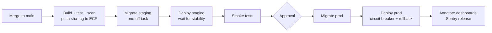

# Deployments — Overview
[← Topic](../README.md)

**TECH:** GitHub Actions builds one image per commit, pushes it to ECR, runs migrations as a one-off ECS task, and deploys the same digest to staging and then production · ECS rolling deployments with the circuit breaker · feature flags to separate deploy from release
**LEVEL:** intermediate (mid-level, has shipped production code)

## Why this matters in production
- Deploys are the most common trigger of incidents. A good pipeline makes them small, frequent, boring, and reversible.
- Rebuilding per environment means production runs something staging never tested.
- Long-lived cloud keys in CI are a favorite target; OIDC removes them.
- Schema changes are what make rollbacks impossible, unless migrations are designed to be backward-compatible.

## Mental model
**Build once, promote the same artifact.** Every merge to `main` produces an immutable image. The pipeline migrates the database (expand-only), deploys to staging, checks it, waits for approval, and deploys the identical digest to production. Releasing features is a separate decision, made with flags.

## Prerequisites
- [01-containers](../../01-containers/README.md), [02-cloud](../../02-cloud/README.md), [03-iac](../../03-iac/README.md).
- [01-foundations/04-ci-cd](../../../01-foundations/04-ci-cd/README.md): pipelines, secure workflows, image builds.
- [03-backend/03-databases lesson 04](../../../03-backend/03-databases/docs/04-drizzle-and-migrations.md): Drizzle migrations and expand/contract.

## Lesson map
| Lesson | Checklist items |
|:--|:--|
| [01 · The pipeline, OIDC, and ECR](01-pipeline-oidc-ecr.md) | 1, 2, 3 |
| [02 · Deploying to ECS: rolling, circuit breaker, blue/green](02-ecs-deploy-strategies.md) | 4, 5, 6 |
| [03 · Migrations, environments, and rollbacks](03-migrations-environments-rollbacks.md) | 7, 8, 10 |
| [04 · Feature flags, frontend deploys, and release hygiene](04-flags-frontend-releases.md) | 9, 11, 12 |
| [Cheatsheet](cheatsheet.md) | all |

## Suggested order
1. 01 → 04.
2. Then [05-data-safety](../../05-data-safety/README.md) and [06-incident-response](../../06-incident-response/README.md).
3. Ready to build: `/learn typescript/04-shipping/04-deployments mode=tasks`.

## Version notes
- GitHub Actions: OIDC to AWS via `aws-actions/configure-aws-credentials`; GitHub environments for approvals and per-environment variables; pin every action to a commit SHA.
- Amazon ECS: rolling deployments with the deployment circuit breaker are the default; ECS also has built-in blue/green deployments (2025) with bake time and lifecycle hooks, plus canary and linear traffic shifting.
- Node 26 runs the Drizzle migrator from the release image (`drizzle-orm`'s `migrate()`), so production images don't need `drizzle-kit`.
- Next.js 16 self-hosted: standalone image plus static assets on S3/CloudFront; keep old assets for clients on the previous version.

## Sources
- [GitHub — Deploying with GitHub Actions](https://docs.github.com/en/actions/use-cases-and-examples/deploying/deploying-with-github-actions)
- [GitHub — Configuring OpenID Connect in AWS](https://docs.github.com/en/actions/security-for-github-actions/security-hardening-your-deployments/configuring-openid-connect-in-amazon-web-services)
- [Amazon ECS — Deployment types](https://docs.aws.amazon.com/AmazonECS/latest/developerguide/deployment-types.html)
- [aws-actions/amazon-ecs-deploy-task-definition](https://github.com/aws-actions/amazon-ecs-deploy-task-definition)
- [DORA — Software delivery performance metrics](https://dora.dev/guides/dora-metrics-four-keys/)
