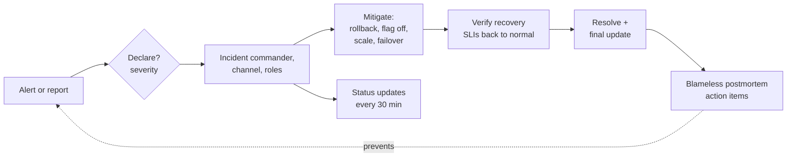

# Incident Response — Overview
[← Topic](../README.md)

**TECH:** Grafana alerts and dashboards, traces and logs in Tempo and Loki (OpenTelemetry), Sentry issues and releases · a lightweight incident process: severities, roles, a channel, status updates, runbooks, blameless postmortems
**LEVEL:** intermediate (mid-level, has shipped production code)

## Why this matters in production
- Every system has incidents. What differs is how fast you notice, how calmly you respond, and whether the same thing happens again.
- Without roles, five people debug the same thing while nobody updates customers or decides to roll back.
- Most incidents follow a change. Teams that mitigate first (rollback, flag off) recover in minutes; teams that hunt for root cause first take hours.
- Postmortems without follow-through produce the same incident again next quarter.

## Mental model
**Detect → declare → mitigate → resolve → learn.** Declare early with a severity, assign an incident commander, stop the user impact before understanding it fully, communicate on a schedule, and turn every incident into concrete fixes through a blameless review.

## Prerequisites
- [03-backend/10-observability](../../../03-backend/10-observability/README.md): the dashboards, traces, logs, and Sentry setup used here.
- [03-backend/08-reliability](../../../03-backend/08-reliability/README.md): SLOs, burn-rate alerts, degradation, game days.
- [04-deployments lesson 03](../../04-deployments/docs/03-migrations-environments-rollbacks.md): rollbacks.

## Lesson map
| Lesson | Checklist items |
|:--|:--|
| [01 · Incidents, roles, and mitigation first](01-incidents-roles-mitigation.md) | 1, 2, 3 |
| [02 · Debugging production with telemetry](02-debugging-with-telemetry.md) | 4, 9 |
| [03 · Communication, on-call, and runbooks](03-communication-oncall-runbooks.md) | 5, 6, 7 |
| [04 · Postmortems, practice, security incidents, and metrics](04-postmortems-practice-security.md) | 8, 10, 11, 12 |
| [Cheatsheet](cheatsheet.md) | all |

## Suggested order
1. 01 → 04.
2. Then [05-practice](../../../05-practice/README.md) and the [capstone](../../../07-capstone/README.md), where a working incident process is a launch requirement.
3. Ready to build: `/learn typescript/04-shipping/06-incident-response mode=tasks`.

## Version notes
- Grafana Alerting routes alerts through contact points and notification policies; deploy annotations and trace-to-logs links make Grafana the starting point of most investigations.
- Paging and incident tooling: Grafana Cloud IRM, PagerDuty, incident.io (also seen); pick one that pages reliably and keeps a timeline.
- Sentry releases mark which deploy introduced an issue; the shared OpenTelemetry setup links Sentry errors to Tempo traces.
- GDPR requires notifying the supervisory authority of a personal data breach within 72 hours of becoming aware of it (where it's a risk to people); NIS2 adds 24-hour early warnings for covered entities.

## Sources
- [Google SRE book — Managing incidents](https://sre.google/sre-book/managing-incidents/)
- [Google SRE book — Postmortem culture](https://sre.google/sre-book/postmortem-culture/)
- [PagerDuty — Incident response documentation](https://response.pagerduty.com/)
- [Atlassian — Incident management handbook](https://www.atlassian.com/incident-management/handbook)
- [Grafana — Alerting](https://grafana.com/docs/grafana/latest/alerting/)
