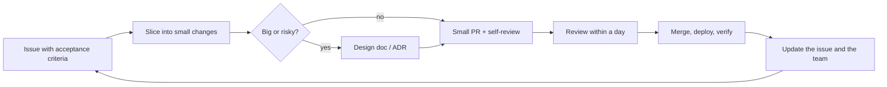

# Engineering Practice — Overview
[← Topic](../README.md)

**TECH:** Git and GitHub as the place where work is planned, reviewed, discussed, and recorded: issues, pull requests, reviews, design docs, and decisions
**LEVEL:** intermediate (mid-level moving towards senior)

This module runs alongside every other module. The mechanics of Git and pull requests are in [01-foundations/01-git](../../../01-foundations/01-git/README.md); this topic is about how experienced engineers **work**: how they slice, review, plan, communicate, debug, and grow.

## Why this matters in production
- Most delays come from waiting and rework, not typing: big PRs waiting for review, unclear tickets, late surprises.
- Code review is the main quality and knowledge-sharing tool of a team. Done badly, it's slow, painful, and catches little.
- Senior engineers are recognized less by the code they write than by the problems they prevent, the clarity they create, and the people they help.
- AI assistants make writing code cheaper and reviewing it more important.

## Mental model
**Small, clear, visible.** Break work into small vertical slices, describe intent before implementation, ship each slice behind review and tests, make risks and decisions visible early, and leave the codebase and the team better than you found them.

## Prerequisites
- [01-foundations/01-git lesson 05](../../../01-foundations/01-git/docs/05-pull-requests-and-protection.md): pull requests, CODEOWNERS, rulesets, merge queue.
- [01-foundations/08-documentation lesson 02](../../../01-foundations/08-documentation/docs/02-decisions-runbooks-changelogs.md): ADRs and changelogs.

## Lesson map
| Lesson | Checklist items |
|:--|:--|
| [01 · Small batches, tickets, and estimates](01-small-batches-planning.md) | 1, 4, 5 |
| [02 · Code review: reviewing and being reviewed](02-code-review.md) | 2, 3 |
| [03 · Technical debt, design docs, and communication](03-debt-design-communication.md) | 6, 7, 8 |
| [04 · Debugging, AI assistants, ownership, and growth](04-debugging-ai-ownership-growth.md) | 9, 10, 11, 12 |
| [Cheatsheet](cheatsheet.md) | all |

## Suggested order
1. 01 → 04, then come back while working through the other modules.
2. The [capstone](../../../07-capstone/README.md) is where all of it is practiced on one project.
3. Ready to build: `/learn typescript/05-practice/01-engineering-practice mode=tasks`.

## Version notes
- GitHub issue forms (`.github/ISSUE_TEMPLATE/*.yml`) and pull request templates make good descriptions the default.
- Rulesets, required reviews, CODEOWNERS, and the merge queue enforce the review process (details in the git topic).
- AI coding assistants are part of daily work; team policies on review, testing, data, and licensing matter more than which tool you use.

## Sources
- [Google — Engineering practices: code review](https://google.github.io/eng-practices/review/)
- [Conventional Comments](https://conventionalcomments.org/)
- [Martin Fowler — Technical debt](https://martinfowler.com/bliki/TechnicalDebt.html)
- [DORA — Capabilities: working in small batches](https://dora.dev/capabilities/working-in-small-batches/)
- [StaffEng — Guides](https://staffeng.com/guides/)
