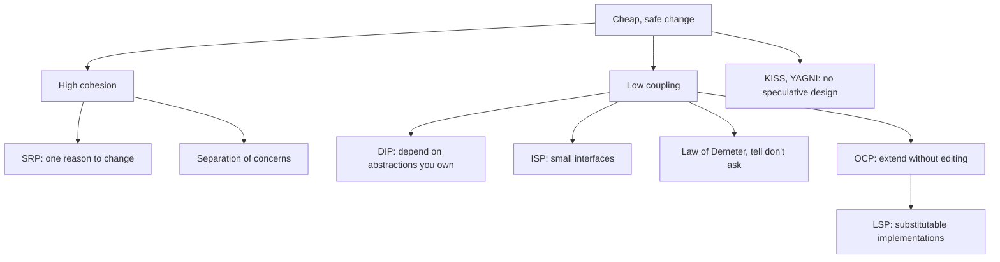

# Design Principles & SOLID — Overview
[← Topic](../README.md)

**TECH:** TypeScript 6 (strict) · examples from the shop codebase used across the backend module
**LEVEL:** intermediate (mid-level, has shipped production code)
**KIND:** concept topic

## Why this matters in production
- Principles explain *why* some code is cheap to change and some isn't. They turn "this feels wrong" into a precise review comment.
- Most expensive bugs come from coupling: a change in one place breaks something far away.
- Applied mechanically, the same principles produce over-engineered code with interfaces nobody needed. Knowing the trade-offs matters as much as knowing the rules.

## Mental model
Two measures drive almost everything: **coupling** (how much one part depends on another's details) should be low, and **cohesion** (how closely the parts of one unit belong together) should be high. SOLID, DRY, the Law of Demeter, and separation of concerns are concrete ways to get there.

## Prerequisites
- [01-paradigms-oop](../../01-paradigms-oop/README.md): encapsulation, composition, polymorphism.

## Lesson map
| Lesson | Checklist items |
|:--|:--|
| [01 · Coupling, cohesion, SRP, and separation of concerns](01-coupling-cohesion-srp.md) | 1, 2, 9 |
| [02 · Open/closed, Liskov, interface segregation, dependency inversion](02-ocp-lsp-isp-dip.md) | 3, 4, 5, 6 |
| [03 · DRY, KISS, YAGNI, Demeter, tell don't ask, CQS](03-dry-kiss-yagni-demeter.md) | 7, 8 |
| [04 · Code smells, refactoring, and principles in review](04-smells-refactoring-review.md) | 10, 11 |
| [Cheatsheet](cheatsheet.md) | all |

## Suggested order
1. 01 → 04.
2. Then [03-design-patterns](../../03-design-patterns/README.md): patterns are principles applied to recurring problems.
3. Ready to build: `/learn typescript/06-design/02-principles mode=tasks` (refactoring katas with starter code).

## Version notes
- Principles are language-independent; examples use TypeScript's structural typing, which makes interface segregation and dependency inversion lightweight (no `implements` needed).
- ESLint rules can back some principles: `max-lines-per-function`, `complexity`, `no-restricted-imports` for dependency direction.

## Sources
- [Robert C. Martin — The principles of OOD](http://butunclebob.com/ArticleS.UncleBob.PrinciplesOfOod)
- [Martin Fowler — Refactoring catalog](https://refactoring.com/catalog/)
- [Kent Beck — Simple design rules (via Martin Fowler)](https://martinfowler.com/bliki/BeckDesignRules.html)
- [The Pragmatic Programmer — DRY](https://pragprog.com/titles/tpp20/the-pragmatic-programmer-20th-anniversary-edition/)
- [refactoring.guru — Code smells](https://refactoring.guru/refactoring/smells)
