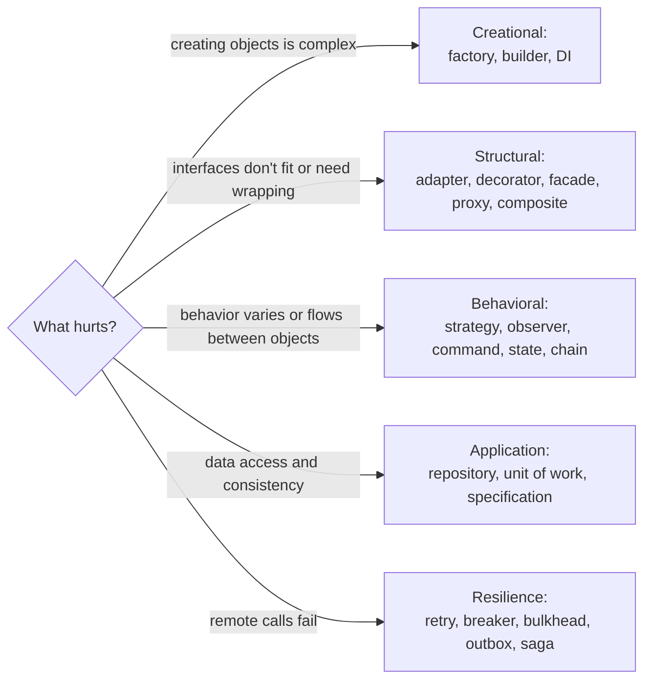

# Design Patterns — Overview
[← Topic](../README.md)

**TECH:** TypeScript 6 (strict) on Node.js 26, with frontend patterns in React 19.2 · the classic Gang of Four catalog, rewritten for a language with first-class functions and structural types
**LEVEL:** intermediate (mid-level, has shipped production code)
**KIND:** concept topic

## Why this matters in production
- Patterns are a shared vocabulary: "put a decorator around the gateway for retries" says in one sentence what otherwise takes a page.
- Many production mechanisms *are* patterns: Express middleware (chain of responsibility), BullMQ events (observer), repositories, adapters for Stripe and SES.
- Misused, patterns produce factories of factories. Knowing the forces behind each one tells you when it pays off.

## Mental model
A pattern is a **named solution to a recurring problem in a context, with trade-offs**. Start from the problem (variation, coupling, lifecycle), pick the simplest pattern that removes the pain, and remember that in TypeScript many patterns collapse into a function, a map of functions, or a closure.

## Prerequisites
- [01-paradigms-oop](../../01-paradigms-oop/README.md) and [02-principles](../../02-principles/README.md).

## Lesson map
| Lesson | Checklist items |
|:--|:--|
| [01 · Creational patterns and dependency injection](01-creational.md) | 1, 2, 3 |
| [02 · Structural patterns](02-structural.md) | 4, 5 |
| [03 · Behavioral patterns](03-behavioral.md) | 6, 7 |
| [04 · Application, resilience, and frontend patterns; anti-patterns](04-application-frontend-antipatterns.md) | 8, 9, 10, 11, 12 |
| [Cheatsheet](cheatsheet.md) | all |

## Suggested order
1. 01 → 04.
2. Then [04-architecture-styles](../../04-architecture-styles/README.md): architecture styles are patterns at system scale.
3. Ready to build: `/learn typescript/06-design/03-design-patterns mode=tasks` (add `lang=java` to see the classic class-based forms).

## Version notes
- ES2015+ generators and iterators implement the iterator pattern natively; `Symbol.asyncIterator` covers streams and paginated APIs.
- `EventTarget` and Node's `EventEmitter` implement observer; `AbortController` is a standard cancellation token (command/observer hybrid).
- `Proxy` and `Reflect` give runtime proxies; use them sparingly (debugging, ORMs) because they hide behavior.

## Sources
- [refactoring.guru — Design patterns](https://refactoring.guru/design-patterns)
- [Gamma, Helm, Johnson, Vlissides — Design Patterns (1994)](https://en.wikipedia.org/wiki/Design_Patterns)
- [Martin Fowler — Patterns of Enterprise Application Architecture](https://martinfowler.com/eaaCatalog/)
- [patterns.dev — JavaScript and React patterns](https://www.patterns.dev/)
- [Microsoft — Cloud design patterns](https://learn.microsoft.com/en-us/azure/architecture/patterns/)
