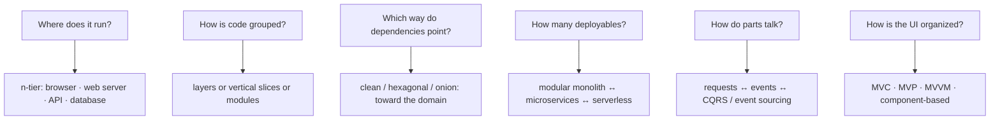

# Architecture Styles — Overview
[← Topic](../README.md)

**TECH:** the shop stack (Next.js 16 + React 19.2 frontend, Express 5 API in TypeScript, PostgreSQL, Redis/BullMQ) used to show each style concretely
**LEVEL:** intermediate (mid-level, has shipped production code)
**KIND:** concept topic

## Why this matters in production
- Architecture styles are the big, expensive choices: how code is split, how parts communicate, and what can change independently.
- Most styles answer different questions, so they combine: a system can be n-tier, a modular monolith, clean inside each module, and event-driven between modules, all at once.
- Teams pick styles from conference talks (microservices, event sourcing) and pay for complexity they didn't need.

## Mental model
Ask what each style organizes: **tiers** (where code runs), **layers** (how code is grouped by concern), **dependency direction** (clean/hexagonal/onion), **slices** (grouping by feature), **deployment units** (monolith vs services), and **communication** (requests vs events). Choose per question, driven by quality attributes.

## Prerequisites
- [02-principles](../../02-principles/README.md) and [03-design-patterns](../../03-design-patterns/README.md).
- [03-backend/11-architecture](../../../03-backend/11-architecture/README.md) implements several of these styles in our stack; this topic gives the full catalog and the trade-offs.

## Lesson map
| Lesson | Checklist items |
|:--|:--|
| [01 · Forces, layers, n-tier, and UI patterns](01-forces-layers-ntier-ui.md) | 1, 2, 3 |
| [02 · Clean, hexagonal, onion, and vertical slices](02-clean-hexagonal-onion-slices.md) | 4, 5 |
| [03 · Modular monolith, microservices, and event-driven architecture](03-monolith-microservices-events.md) | 6, 7, 8 |
| [04 · CQRS, event sourcing, serverless, decisions, and combining styles](04-cqrs-serverless-combining.md) | 9, 10, 11, 12 |
| [Cheatsheet](cheatsheet.md) | all |

## Suggested order
1. 01 → 04.
2. Then [05-domain-driven-design](../../05-domain-driven-design/README.md) to decide *what* the modules are, and the [capstone](../../../07-capstone/01-design-build/README.md) where all styles meet.
3. Practice: `/design "split the orders module" area=architecture`, or `/learn typescript/06-design/04-architecture-styles mode=tasks`.

## Version notes
- Next.js 16 App Router: Server Components render on the server (a presentation tier of its own), Client Components handle interaction; Server Actions blur the line between UI and API, so keep business rules in the API.
- Express 5 handles async errors natively, which keeps the HTTP adapter (controllers) thin.
- Node's type stripping rules out decorator-based frameworks without a build step; plain functions and modules carry these styles well.

## Sources
- [Mark Richards, Neal Ford — Fundamentals of Software Architecture (overview)](https://www.oreilly.com/library/view/fundamentals-of-software/9781492043447/)
- [Robert C. Martin — The clean architecture](https://blog.cleancoder.com/uncle-bob/2012/08/13/the-clean-architecture.html)
- [Alistair Cockburn — Hexagonal architecture](https://alistair.cockburn.us/hexagonal-architecture/)
- [Martin Fowler — Microservices](https://martinfowler.com/articles/microservices.html)
- [Microsoft — Architecture styles](https://learn.microsoft.com/en-us/azure/architecture/guide/architecture-styles/)
