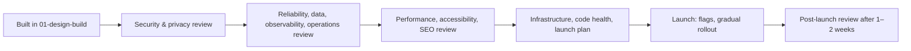

# Pre-Launch Checklist — Overview
[← Topic](../README.md)

**TECH:** Roastery from [01-design-build](../../01-design-build/README.md), reviewed end to end before real customers arrive
**LEVEL:** senior: you verify, not just build
**KIND:** capstone: each document is a review with "how to verify" for every item; tasks are review milestones

## Why this matters in production
- Launch day is the worst time to discover that backups were never restored, alerts go nowhere, or checkout breaks with a screen reader.
- A checklist with **evidence** (a command, a test, a dashboard link) turns "I think it's fine" into "here's proof".
- This is the course's final exam: every module shows up as a section.

## Mental model
For each area, **claim → evidence → owner**. An item is done only when the evidence exists and someone owns keeping it true after launch.

## Prerequisites
- [01-design-build](../../01-design-build/README.md) milestones M1–M7 done.
- The topics linked from each review item.

## Lesson map
| Document | Checklist items |
|:--|:--|
| [01 · Security and privacy review](01-security-privacy-review.md) | 1, 2 |
| [02 · Reliability, data, observability, and operations review](02-reliability-data-observability-ops.md) | 3, 4, 5, 6 |
| [03 · Performance, accessibility, and SEO review](03-performance-accessibility-seo.md) | 7, 8, 9 |
| [04 · Infrastructure, code health, and the launch plan](04-infrastructure-code-launch.md) | 10, 11, 12 |
| [Cheatsheet](cheatsheet.md) | all |

## Suggested order
1. 01 → 04, fixing findings as you go; record evidence links in `docs/launch/readiness.md`.
2. Generate the review milestones: `/learn typescript/07-capstone/02-pre-launch mode=tasks`, then `/review typescript/07-capstone/02-pre-launch Txx` per milestone.

## Version notes
- OWASP Top 10:2025 categories and NIST SP 800-63B rev. 4 password guidance are the security baseline ([01-foundations/06-security](../../../01-foundations/06-security/README.md)).
- WCAG 2.2 AA is the accessibility baseline; the European Accessibility Act applies to many consumer e-commerce sites since June 2025.
- Core Web Vitals: LCP, INP, CLS at the 75th percentile of real users.

## Sources
- [Google SRE — Production readiness review (launch coordination)](https://sre.google/sre-book/reliable-product-launches/)
- [OWASP Top 10](https://owasp.org/Top10/)
- [W3C — WCAG 2.2](https://www.w3.org/TR/WCAG22/)
- [web.dev — Core Web Vitals](https://web.dev/articles/vitals)
- [AWS Well-Architected Framework](https://docs.aws.amazon.com/wellarchitected/latest/framework/welcome.html)
